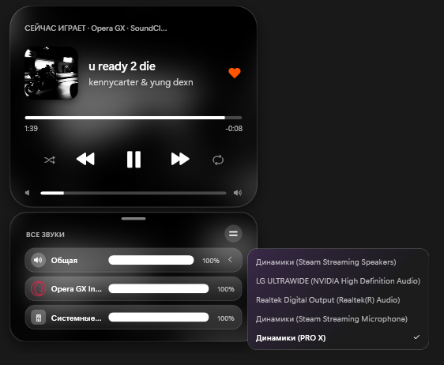

# Now Playing — iOS-style player & mixer widget for Windows

**[Русская версия ниже ↓](#сейчас-играет--виджет-плеера-и-микшера-в-стиле-ios)**

A small desktop widget for Windows 10/11 in the style of the iOS lock screen player: cover art with a blurred
background, seek bar, playback controls and a built-in volume mixer. It works with anything that reports to
Windows media controls (browsers, Spotify, players), and has deep extra integration with **SoundCloud**.

> 💡 This is my first app. I'm not a programmer by training — I built it entirely through **vibe coding**.



*The player with the built-in mixer (master and per-app volume) and the output device switcher.*

## Features

- **Player:** cover art, blurred background from the cover, seek bar, ⏮ ⏯ ⏭.
- **SoundCloud extras** (via the bundled browser extension): 🔀 shuffle, 🔁 repeat (off → track → playlist), ❤️ like,
  and volume of **only the track** — not the whole browser.
- **Mixer:** master volume, volume of every app, mute by clicking an icon, output device switcher
  (headphones / speakers / monitor) right from the widget.
- **Detachable mixer:** split the mixer into its own widget and snap it back with one click.
- **Listening stats for SoundCloud:** top artists and tracks, discoveries (who you started listening to and when),
  history with search, artist and track pages, habits and streaks, skips, charts by day, hour and weekday.
  Everything is stored locally on your computer.
- Glass look, resize (corner grip or Ctrl + mouse wheel), lock 🔒, always on top 📌, tray icon, autostart.
- **Two languages:** English and Russian — choose in the installer or later in the tray menu (*Язык / Language*).

## Install

1. Download `NowPlaying-Setup.exe` from [Releases](../../releases).
2. Run it, pick the language and click **Install**. No admin rights are needed; it installs to
   `%LOCALAPPDATA%\Programs\NowPlaying`.
3. The exe is not code-signed, so Windows SmartScreen may warn you: click **More info → Run anyway**.
   The full source code is here, so you can check what it does or build it yourself.

### SoundCloud extension (optional)

Browsers don't tell Windows about repeat, shuffle and likes, so a tiny extension passes them to the widget.

1. Open `opera://extensions` (Opera / Opera GX) or `chrome://extensions` (Chrome, Edge: `edge://extensions`).
2. Turn on **Developer mode** → **Load unpacked**.
3. Choose the folder `%LOCALAPPDATA%\Programs\NowPlaying\soundcloud-extension`
   (tray icon menu → *SoundCloud extension (folder)* opens it).
4. Reload the SoundCloud tab (F5).

The extension only talks to the widget on your own computer (`http://127.0.0.1:48251`). Nothing is sent anywhere else.

## How it works

- The widget reads the current track from Windows media sessions
  (`GlobalSystemMediaTransportControlsSessionManager`) and controls app volumes through WASAPI.
- The extension looks at the SoundCloud page like a person would: reads the state of the repeat / shuffle / like
  buttons and the current track every 0.7 s, sends it to the widget and clicks buttons when the widget asks.
  A small script inside the page remembers the audio element, so the widget can change only the track volume.
- A track counts as a play after 30 seconds of actual playback; switching at 3–30 seconds counts as a skip.
  Plays are saved to `listens.jsonl` in the install folder; the stats page is generated from it and opened in your browser.

## Build from source

No Visual Studio or .NET SDK needed — the C# compiler that ships with Windows (.NET Framework 4.x) is enough.
From the project folder in PowerShell:

```powershell
powershell -ExecutionPolicy Bypass -File .\build-setup.ps1
```

This builds `NowPlaying.exe` and packs it with the icon and the extension into `release\NowPlaying-Setup.exe`.

| File | What it is |
|---|---|
| `NowPlaying.cs` | the player window, SoundCloud bridge, tray |
| `SoundPanel.cs` | the volume strip, mixer, detached mixer, output devices |
| `MixerParts.cs` | WASAPI (Core Audio) interop and mixer controls |
| `Listens.cs`, `StatsPage.cs` | listening stats and the stats page template |
| `Lang.cs` | English / Russian texts |
| `installer\Setup.cs` | the installer and uninstaller |
| `extension\` | the browser extension for SoundCloud |

## License

[MIT](LICENSE) © 2026 DUUjaysk

---

# «Сейчас играет» — виджет плеера и микшера в стиле iOS

Виджет для Windows 10/11 в стиле плеера с экрана блокировки iOS: обложка с размытым фоном, перемотка,
кнопки управления и встроенный микшер громкости. Работает со всем, что передаёт музыку в Windows (браузеры,
Spotify, плееры), а с **SoundCloud** интегрирован особенно глубоко.

> 💡 Это моё первое приложение. Программированию я специально не учился — сделал его целиком через **вайбкодинг**.


*Плеер со встроенным микшером (общая громкость и громкость каждого приложения) и выбором устройства вывода звука.*

## Возможности

- **Плеер:** обложка, размытый фон из неё, перемотка, ⏮ ⏯ ⏭.
- **Для SoundCloud** (через расширение из комплекта): 🔀 перемешивание, 🔁 повтор (выкл → трек → плейлист), ❤️ лайк
  и громкость **только трека**, а не всего браузера.
- **Микшер:** общая громкость, громкость каждого приложения, выключение звука кликом по значку, выбор устройства
  вывода (наушники / колонки / монитор) прямо в виджете.
- **Отделяемый микшер:** микшер можно вынести в отдельный виджет и вернуть одной кнопкой.
- **Статистика прослушиваний SoundCloud:** топ артистов и треков, «открытия» (кого и когда ты начал слушать),
  история с поиском, страницы артиста и трека, привычки и серии, пропуски, графики по дням, часам и дням недели.
  Всё хранится только на твоём компьютере.
- Стиль «стекла», изменение размера (уголок или Ctrl + колёсико), замок 🔒, поверх всех окон 📌, трей, автозапуск.
- **Два языка:** русский и английский — выбор в установщике или потом в меню значка в трее («Язык / Language»).

## Установка

1. Скачай `NowPlaying-Setup.exe` в разделе [Releases](../../releases).
2. Запусти, выбери язык и нажми **«Установить»**. Права администратора не нужны, программа ставится в
   `%LOCALAPPDATA%\Programs\NowPlaying`.
3. Exe не подписан, поэтому Windows SmartScreen может предупредить: нажми **«Подробнее» → «Выполнить в любом случае»**.
   Весь исходный код лежит здесь — можно проверить, что программа делает, или собрать её самому.

### Расширение для SoundCloud (по желанию)

Браузеры не передают Windows повтор, перемешивание и лайк, поэтому их передаёт виджету маленькое расширение.

1. Открой `opera://extensions` (Opera / Opera GX) или `chrome://extensions` (Chrome; в Edge — `edge://extensions`).
2. Включи **«Режим разработчика»** → **«Загрузить распакованное»**.
3. Выбери папку `%LOCALAPPDATA%\Programs\NowPlaying\soundcloud-extension`
   (её открывает пункт меню значка в трее «Расширение для SoundCloud (папка)»).
4. Обнови вкладку SoundCloud (F5).

Расширение общается только с виджетом на твоём же компьютере (`http://127.0.0.1:48251`) и никуда ничего не отправляет.

## Сборка из исходников

Visual Studio и .NET SDK не нужны — хватает компилятора C#, который есть в Windows (.NET Framework 4.x).
В PowerShell из папки проекта:

```powershell
powershell -ExecutionPolicy Bypass -File .\build-setup.ps1
```

Получится `release\NowPlaying-Setup.exe` — внутри программа, значок и расширение.

## Лицензия

[MIT](LICENSE) © 2026 DUUjaysk
